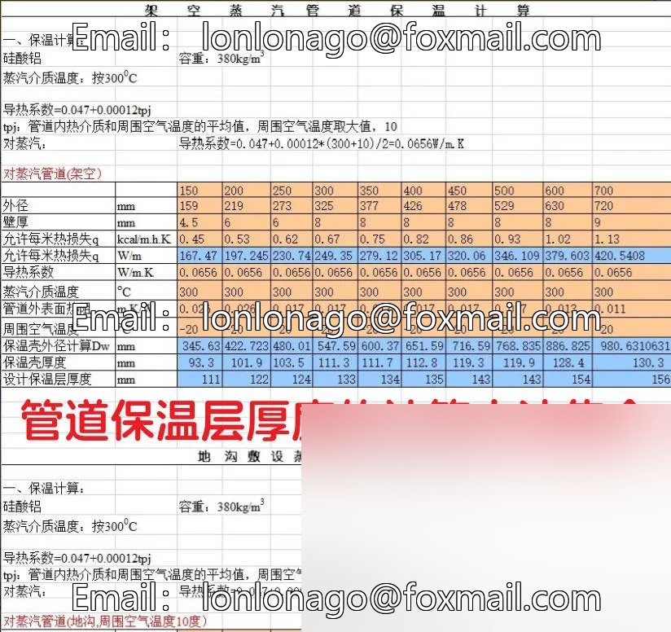
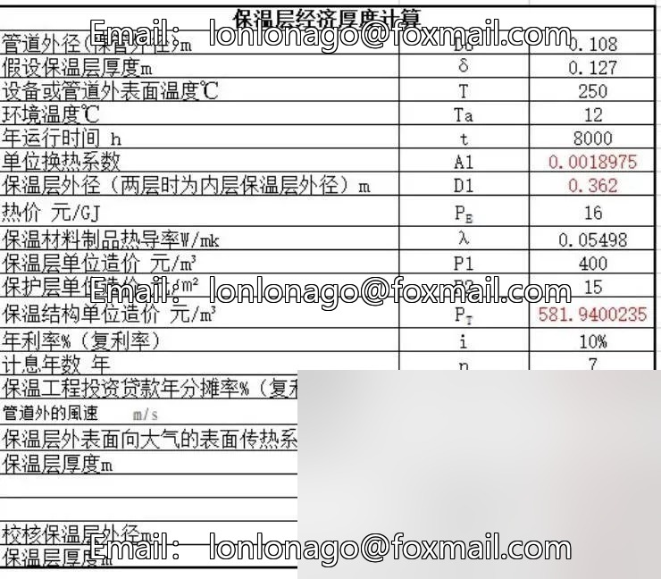
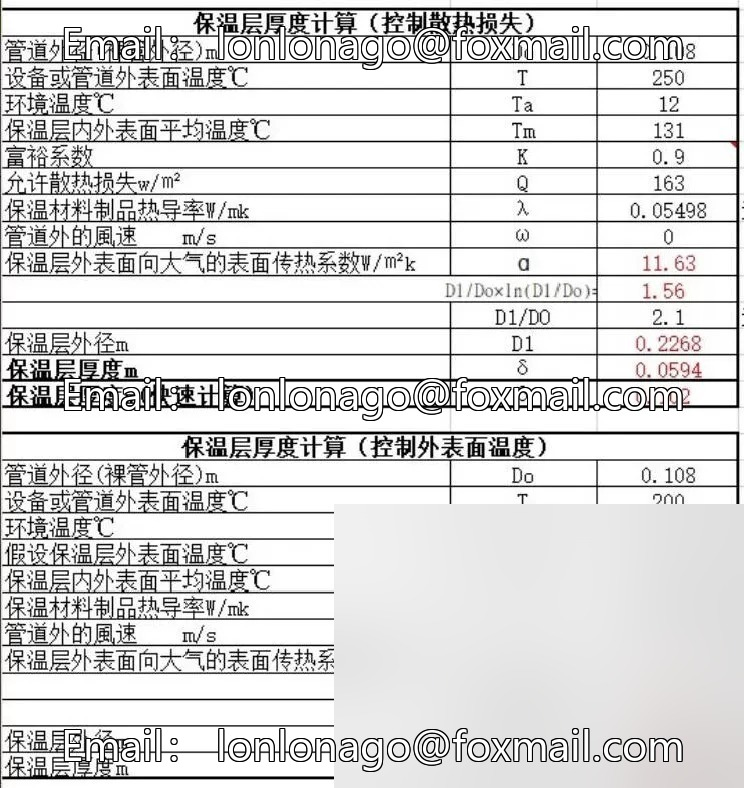
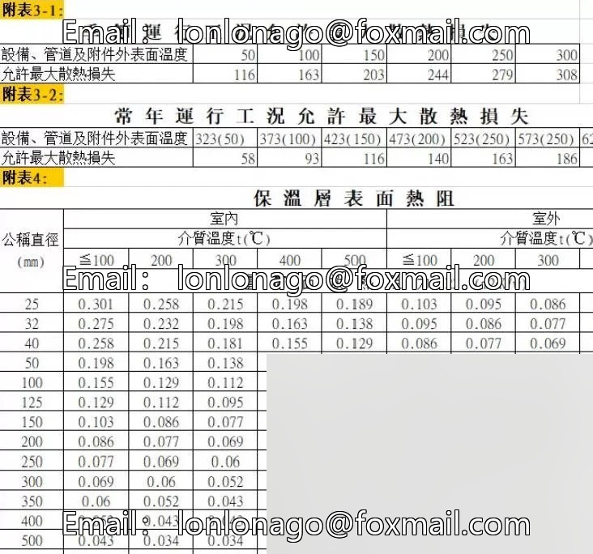

# The calculation method for the thickness of the piping thermal insulation layer

## Body

The calculation method for the thickness of the piping thermal insulation layer
Standard: Boiler room design specifications General code for adiabatic technology of equipment and pipelines, Principles for adiabatic design of equipment and piping, Power pipe design manual Industrial boiler economic operation Boiler energy saving technical supervision and management regulations.

Thermal insulation layer economic thickness calculation Insulation layer thickness calculation (controlling heat dissipation loss) Insulation layer thickness calculation (controlling the surface temperature) Thermal loss calculation on the insulation layer surface and temperature calculation on the exterior surface

Vapor-insulated pipe calculation for abovetop pipe, steam pipe insulation calculation for trench installation, vapor-insulated hot oil pipe insulation calculation, and hot water pipe insulation calculation for trench installation

web-based shipment, can be directly photographed and shipped.

The content covers the calculation method for pipe insulation thickness, including standard references, multiple insulation calculation types and specific parameters.

<!-- AI_ENRICHED -->

## Images

## Payment

Here is a pay link on Stripe ( https://buy.stripe.com/3cs8yP7sY87d0vu9AB ). Please contact me lonlonago@foxmail.com after funding $89, and I will send you a complete data files , thank you!

